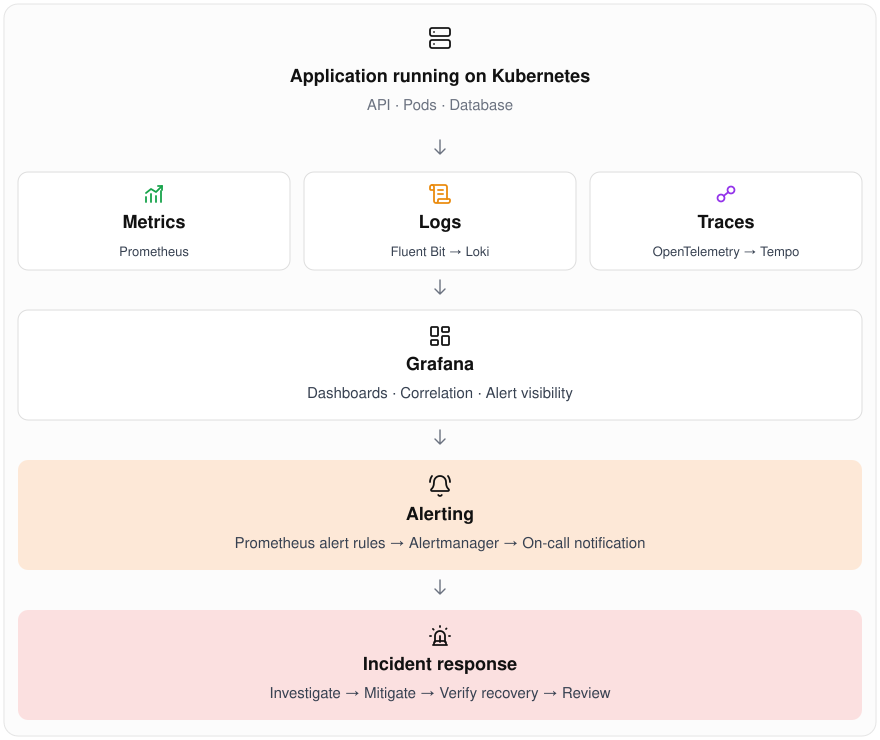
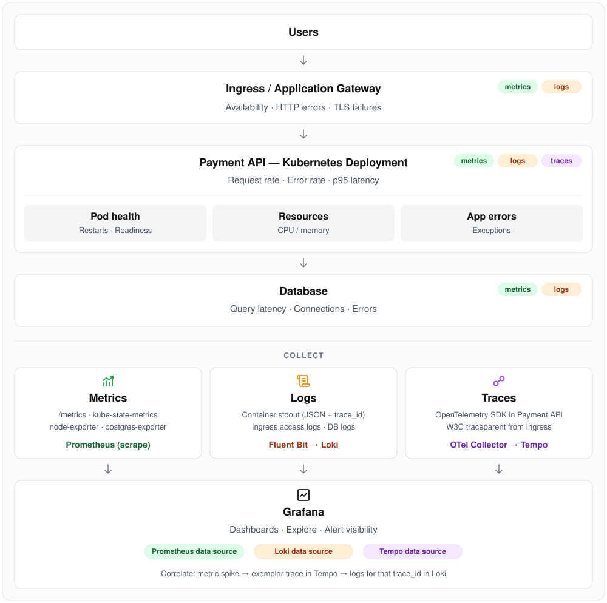

# Day 01 · Observability Baseline

> **Goal:** know what "good enough" observability looks like for one service, and how a signal turns into an incident.

| Section | Today |
|---|---|
| Concept | The three signals (metrics, logs, traces) plus alerts |
| Draw | Metrics → logs → traces → alerts → incident flow |
| Build | A simple [service observability map](service-observability-map.md) |

---

## 1. Concept

**Monitoring** tells you *that* something is wrong. **Observability** lets you work out *why*, using data the system already emits, without shipping new code.

| Signal | Answers | Shape | Typical tools |
|---|---|---|---|
| **Metrics** | *Is it healthy? How much? How fast?* | Numbers over time, cheap to store | Prometheus, Azure Monitor, CloudWatch |
| **Logs** | *What exactly happened?* | Timestamped events, ideally structured JSON | Loki, Elasticsearch, Log Analytics |
| **Traces** | *Where did the time go across services?* | Spans linked by a trace ID | OpenTelemetry, Jaeger, Tempo, App Insights |
| **Alerts** | *Does a human need to act now?* | Rules on metrics (or logs) | Alertmanager, Azure Monitor alerts |

### The baseline: what every service should have

1. **Golden signals** as metrics: **latency**, **traffic**, **errors**, **saturation**.
2. **Structured logs** with `level`, `service`, `trace_id` and `request_id` on every line.
3. **Trace context propagation** (W3C `traceparent` header) across every hop.
4. **One SLO** per user-facing service (for example 99.5% of requests succeed in under 300 ms).
5. **Symptom-based alerts** that link to a dashboard and a runbook.
6. **A dashboard** a new on-call engineer can read in 30 seconds.

> 💡 Rule of thumb: alert on **symptoms users feel** (error rate, latency), not on **causes** (CPU at 80%). Causes go on dashboards.

### RED and USE

- **RED** for request-driven services: **R**ate, **E**rrors, **D**uration.
- **USE** for resources (nodes, disks, queues): **U**tilization, **S**aturation, **E**rrors.

### SLI, SLO, SLA and error budget

| Term | What it is | Who owns it | Payment API example |
|---|---|---|---|
| **SLI** (Service Level *Indicator*) | A measurement: good events ÷ total events | Engineering | % of `POST /pay` requests that return non-5xx in under 300 ms |
| **SLO** (Service Level *Objective*) | The internal target for an SLI over a time window | Engineering + product | 99.9% over a rolling 30 days |
| **SLA** (Service Level *Agreement*) | A contractual promise to customers, with penalties | Business / legal | 99.5% monthly availability, or customers get service credits |
| **Error budget** | `100% − SLO`: how much failure is allowed | Everyone | 0.1% of requests, about 43 min of full outage per 30 days |

**How they fit together:** the **SLI** measures, the **SLO** sets the target, and the **SLA** is the external promise. Keep **SLA < SLO < 100%**. The stricter internal SLO warns you before you break the contract, and 100% is never the right target.

**Example SLI in PromQL** (availability over 30 days):

```promql
sum(rate(http_requests_total{service="payment-api", status!~"5.."}[30d]))
/
sum(rate(http_requests_total{service="payment-api"}[30d]))
```

#### Error budget at a glance (30-day window)

| SLO | Allowed downtime | Failed requests allowed per 10M |
|---|---|---|
| 99% | 7 h 12 m | 100,000 |
| 99.5% | 3 h 36 m | 50,000 |
| 99.9% | 43 m 12 s | 10,000 |
| 99.95% | 21 m 36 s | 5,000 |
| 99.99% | 4 m 19 s | 1,000 |

#### Using the error budget

- **Budget left:** ship features, run experiments and do risky migrations.
- **Budget burned:** freeze risky releases and spend the time on reliability work (fixes, tests, capacity).
- The budget turns "move fast" vs "stay stable" into a number both dev and ops agree on.

#### Alert on burn rate, not on every error

**Burn rate** is how fast you are spending the budget. A burn rate of **1×** uses exactly the whole budget in 30 days.

| Burn rate | Measured over | Budget spent | Action |
|---|---|---|---|
| 14.4× | 1 h (confirmed over 5 m) | 2% | 🔴 Page |
| 6× | 6 h (confirmed over 30 m) | 5% | 🔴 Page |
| 1× | 3 days (confirmed over 6 h) | 10% | 🟠 Ticket |

This catches fast outages quickly and slow leaks eventually, without paging on every small spike.

---

## 2. Draw: metrics → logs → traces → alerts → incident

<p align="center">
  
</p>

**How to read it**

1. The app emits three signals, linked by `trace_id`: Prometheus scrapes metrics, Fluent Bit ships container logs to Loki, and OpenTelemetry sends traces to Tempo.
2. **Metrics drive alerts** because they are cheap, fast and aggregate well.
3. An alert pages on-call, and an **incident** is opened.
4. Triage goes **wide to narrow**: dashboard (metrics) → slow or failing trace → logs for that `trace_id` → root cause.
5. Mitigate with the runbook, then hold a **postmortem** that feeds back into better alerts and dashboards.

### Service map: architecture + signal collection

The top half is the service architecture. Each layer is tagged with the signals it emits. The bottom half shows how those signals are collected and correlated in Grafana.

<p align="center">
  
</p>

Key incident metrics to track over time: **MTTD** (time to detect), **MTTA** (time to acknowledge) and **MTTR** (time to recover).

---

## 3. Build: a simple service observability map

👉 See **[service-observability-map.md](service-observability-map.md)**.

It is a one-page map for a sample `checkout-api` service: its dependencies, the signals it emits, its SLO, alerts, dashboards and runbooks. Copy the template at the bottom and fill it in for a service you own.

---

## ✅ Day 01 checklist

- [ ] I can explain metrics vs logs vs traces in one sentence each
- [ ] I can name the four golden signals: latency, traffic, errors, saturation
- [ ] I can explain SLI vs SLO vs SLA, and work out the error budget for a 99.9% SLO
- [ ] I drew the metrics → logs → traces → alerts → incident flow
- [ ] I built an observability map for one service
- [ ] Every alert on that map links to a dashboard and a runbook

## 📚 Further reading

- [Google SRE Book: Monitoring Distributed Systems](https://sre.google/sre-book/monitoring-distributed-systems/)
- [OpenTelemetry documentation](https://opentelemetry.io/docs/)
- [Prometheus alerting best practices](https://prometheus.io/docs/practices/alerting/)

---

⬅️ [Back to all days](../README.md)
