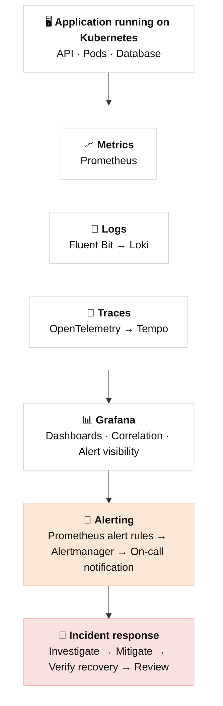
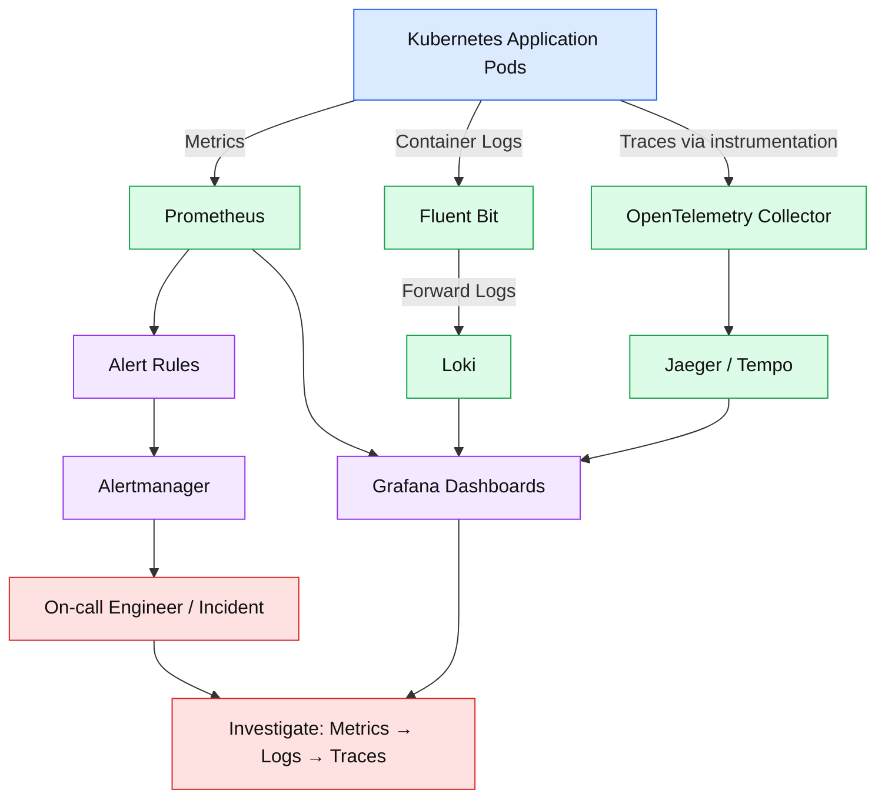

# Day 01 · Observability Baseline

> **Goal:** know what "good enough" observability looks like for one service, and how a signal turns into an incident.

| Section | Today |
|---|---|
| Concept | The three signals (metrics, logs, traces) plus alerts |
| Draw | Metrics → logs → traces → alerts → incident flow |
| Build | A simple [service observability map](service-observability-map.md) |

---

## 1. Concept

**Monitoring** tells you *that* something is wrong. **Observability** lets you work out *why*, using data the system already emits, without shipping new code.

| Signal | Answers | Shape | Typical tools |
|---|---|---|---|
| **Metrics** | *Is it healthy? How much? How fast?* | Numbers over time, cheap to store | Prometheus, Azure Monitor, CloudWatch |
| **Logs** | *What exactly happened?* | Timestamped events, ideally structured JSON | Loki, Elasticsearch, Log Analytics |
| **Traces** | *Where did the time go across services?* | Spans linked by a trace ID | OpenTelemetry, Jaeger, Tempo, App Insights |
| **Alerts** | *Does a human need to act now?* | Rules on metrics (or logs) | Alertmanager, Azure Monitor alerts |

### The baseline: what every service should have

1. **Golden signals** as metrics: **latency**, **traffic**, **errors**, **saturation**.
2. **Structured logs** with `level`, `service`, `trace_id` and `request_id` on every line.
3. **Trace context propagation** (W3C `traceparent` header) across every hop.
4. **One SLO** per user-facing service (for example 99.5% of requests succeed in under 300 ms).
5. **Symptom-based alerts** that link to a dashboard and a runbook.
6. **A dashboard** a new on-call engineer can read in 30 seconds.

> 💡 Rule of thumb: alert on **symptoms users feel** (error rate, latency), not on **causes** (CPU at 80%). Causes go on dashboards.

### RED and USE

- **RED** for request-driven services: **R**ate, **E**rrors, **D**uration.
- **USE** for resources (nodes, disks, queues): **U**tilization, **S**aturation, **E**rrors.

---

## 2. Draw: metrics → logs → traces → alerts → incident

**How to read it**

1. The app emits three signals, linked by `trace_id`: Prometheus scrapes metrics, Fluent Bit ships container logs to Loki, and OpenTelemetry sends traces to Tempo.
2. **Metrics drive alerts** because they are cheap, fast and aggregate well.
3. An alert pages on-call, and an **incident** is opened.
4. Triage goes **wide to narrow**: dashboard (metrics) → slow or failing trace → logs for that `trace_id` → root cause.
5. Mitigate with the runbook, then hold a **postmortem** that feeds back into better alerts and dashboards.

### Observability architecture: metrics, logs and traces

Key incident metrics to track over time: **MTTD** (time to detect), **MTTA** (time to acknowledge) and **MTTR** (time to recover).

---

## 3. Build: a simple service observability map

👉 See **[service-observability-map.md](service-observability-map.md)**.

It is a one-page map for a sample `checkout-api` service: its dependencies, the signals it emits, its SLO, alerts, dashboards and runbooks. Copy the template at the bottom and fill it in for a service you own.

---

## ✅ Day 01 checklist

- [ ] I can explain metrics vs logs vs traces in one sentence each
- [ ] I can name the four golden signals
- [ ] I drew the metrics → logs → traces → alerts → incident flow
- [ ] I built an observability map for one service
- [ ] Every alert on that map links to a dashboard and a runbook

## 📚 Further reading

- [Google SRE Book: Monitoring Distributed Systems](https://sre.google/sre-book/monitoring-distributed-systems/)
- [OpenTelemetry documentation](https://opentelemetry.io/docs/)
- [Prometheus alerting best practices](https://prometheus.io/docs/practices/alerting/)

---

⬅️ [Back to all days](../README.md)
