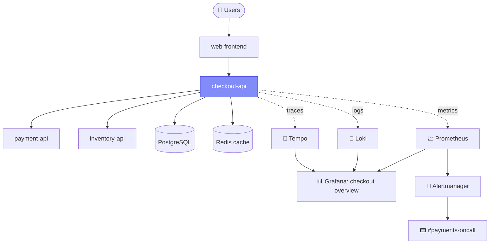

# Service Observability Map · `checkout-api`

A one-page map of what we observe for one service, and where to look when it breaks.

## 1. Service context

| Field | Value |
|---|---|
| **Service** | `checkout-api` |
| **Owner** | Payments team · `#payments-oncall` |
| **Runtime** | Kubernetes (AKS), 3 replicas, HPA 3–10 |
| **Criticality** | Tier 1 (revenue path) |
| **Upstream** | `web-frontend`, `mobile-bff` |
| **Downstream** | `payment-api`, `inventory-api`, PostgreSQL, Redis |

## 2. Map



## 3. Signals

### Metrics (RED + USE)

| Signal | Metric (PromQL) | Healthy |
|---|---|---|
| Rate | `sum(rate(http_requests_total{service="checkout-api"}[5m]))` | baseline ± 30% |
| Errors | `sum(rate(http_requests_total{service="checkout-api",status=~"5.."}[5m])) / sum(rate(http_requests_total{service="checkout-api"}[5m]))` | < 0.5% |
| Duration (p95) | `histogram_quantile(0.95, sum by (le) (rate(http_request_duration_seconds_bucket{service="checkout-api"}[5m])))` | < 300 ms |
| Saturation (CPU) | `sum(rate(container_cpu_usage_seconds_total{pod=~"checkout-api.*"}[5m]))` | < 70% of request |
| Saturation (DB pool) | `db_pool_connections_in_use / db_pool_connections_max` | < 80% |

### Logs

- Format: JSON to stdout, shipped by Promtail to Loki
- Required fields: `timestamp`, `level`, `service`, `trace_id`, `request_id`, `route`, `status`, `duration_ms`
- Example query: `{service="checkout-api"} | json | level="error"`

```json
{"timestamp":"2026-10-22T09:14:03Z","level":"error","service":"checkout-api","trace_id":"4bf92f3577b34da6","request_id":"r-81c2","route":"POST /checkout","status":502,"duration_ms":3004,"msg":"payment-api timeout"}
```

### Traces

- SDK: OpenTelemetry, exported over OTLP to Tempo
- Propagation: W3C `traceparent` to `payment-api` and `inventory-api`
- Key spans: `POST /checkout` → `inventory.reserve` → `payment.charge` → `db.insert_order`
- Sampling: 10% head sampling, plus 100% of errors (tail sampling)

## 4. SLO

| SLI | Target | Window | Error budget |
|---|---|---|---|
| Successful `POST /checkout` (non-5xx) in under 300 ms | **99.5%** | 30 days | ~3.6 h |

## 5. Alerts

| Alert | Condition | Severity | Routes to | Runbook |
|---|---|---|---|---|
| `CheckoutHighErrorRate` | 5xx ratio > 2% for 5m | 🔴 page | `#payments-oncall` | `runbooks/checkout-errors.md` |
| `CheckoutSLOFastBurn` | burn rate > 14.4× over 1h and 5m | 🔴 page | `#payments-oncall` | `runbooks/checkout-slo.md` |
| `CheckoutHighLatency` | p95 > 500 ms for 10m | 🟠 ticket | Payments board | `runbooks/checkout-latency.md` |
| `CheckoutDBPoolSaturated` | pool usage > 90% for 10m | 🟠 ticket | Payments board | `runbooks/db-pool.md` |

Every alert must have a **dashboard link** and a **runbook link** in its annotations.

## 6. Dashboards

| Dashboard | Purpose |
|---|---|
| **Checkout overview** | RED panels, SLO burn, error budget left |
| **Checkout dependencies** | Latency and errors per downstream call |
| **Checkout infra** | Pod CPU and memory, restarts, HPA replicas, DB pool |

## 7. Triage path (wide → narrow)

1. **Alert** fires → open the *Checkout overview* dashboard.
2. **Metrics**: which route or status code? Did it start with a deploy?
3. **Traces**: open an exemplar of a slow or failed request and find the slow span.
4. **Logs**: filter by `trace_id` to read the exact error.
5. **Act**: roll back, scale, or fail over using the runbook.
6. **Learn**: postmortem, then add or tune an alert or dashboard panel.

## 8. Gaps / TODO

- [ ] `inventory-api` does not propagate `traceparent` yet
- [ ] No synthetic check for the full checkout journey
- [ ] Redis has no saturation alert

---

## 📋 Blank template (copy for your service)

```markdown
# Service Observability Map · `<service-name>`

## Service context
| Field | Value |
|---|---|
| Service | |
| Owner / on-call | |
| Runtime | |
| Criticality | |
| Upstream | |
| Downstream | |

## Signals
- Metrics (RED/USE): rate · errors · duration · saturation
- Logs: format, required fields, where they go
- Traces: SDK, propagation, key spans, sampling

## SLO
| SLI | Target | Window | Error budget |
|---|---|---|---|

## Alerts
| Alert | Condition | Severity | Routes to | Runbook |
|---|---|---|---|---|

## Dashboards
| Dashboard | Purpose |
|---|---|

## Triage path
1. Alert → 2. Dashboard → 3. Trace → 4. Logs → 5. Act → 6. Learn

## Gaps / TODO
- [ ]
```

---

⬅️ [Back to Day 01](README.md)
